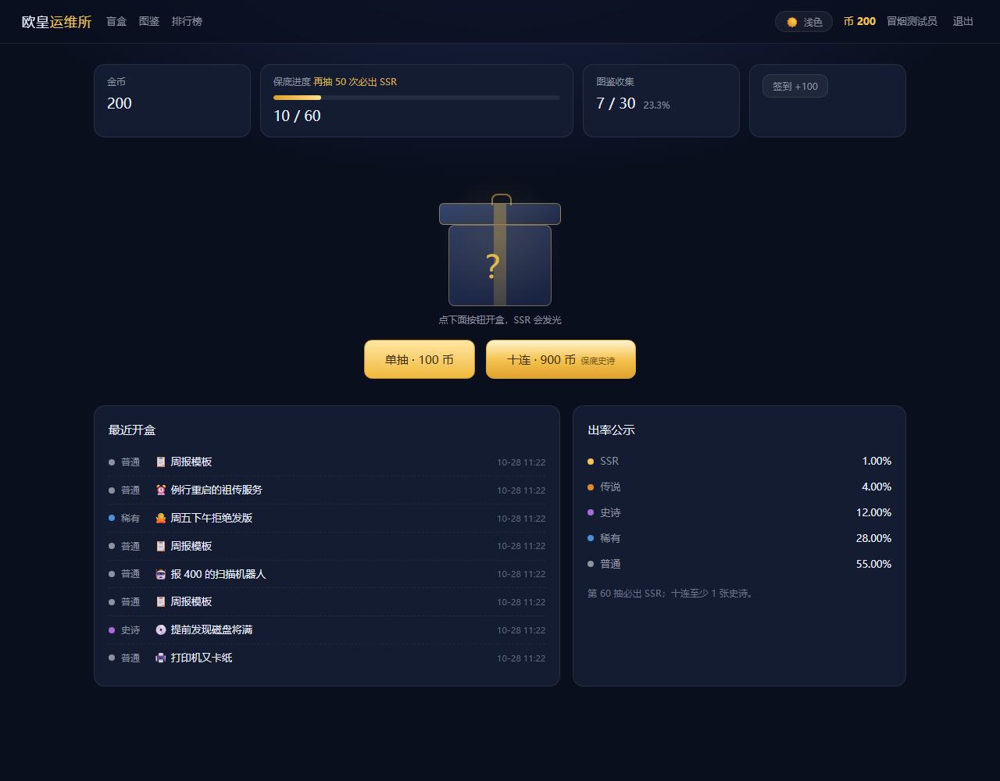
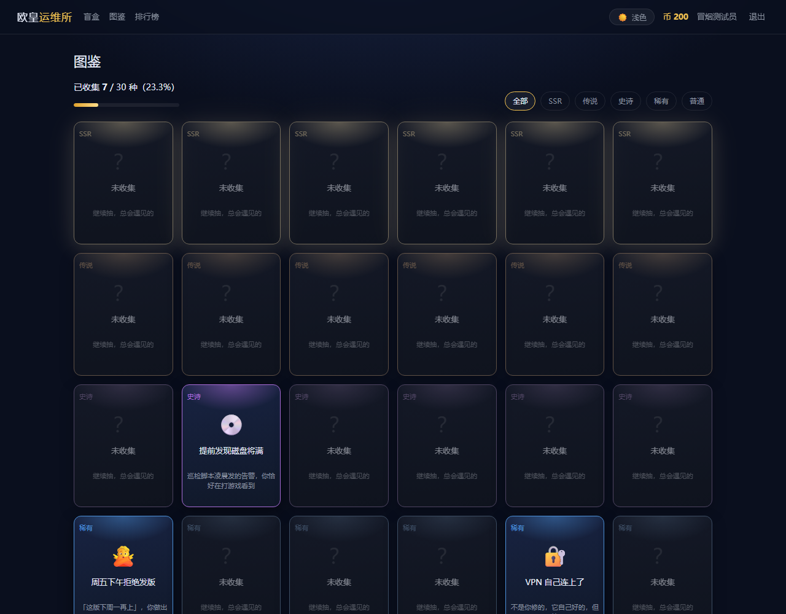
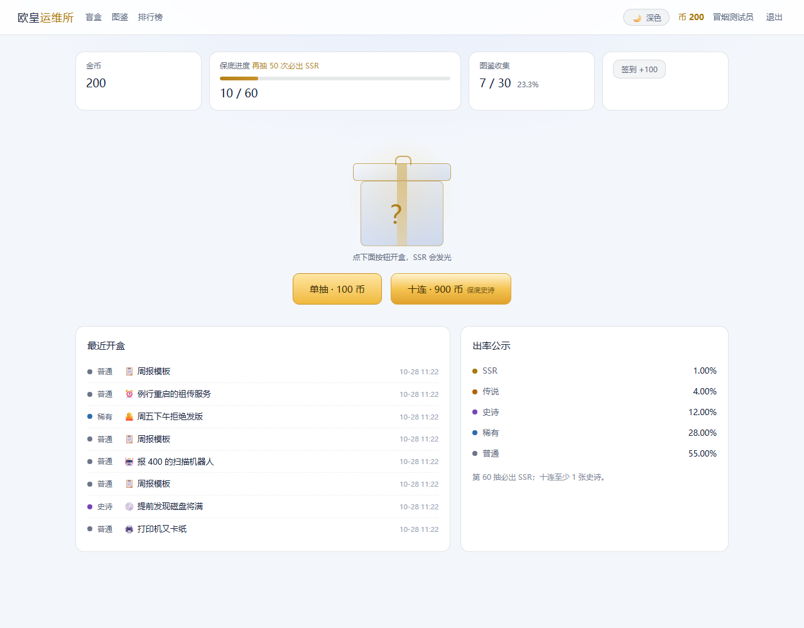
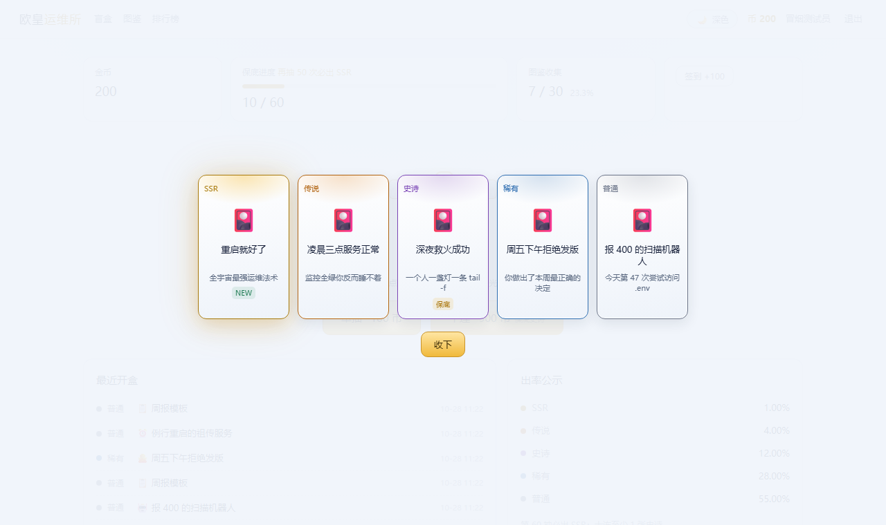

# 欧皇运维所 · 抽盲盒小游戏

一个跑在本地的多用户抽卡收集游戏：**注册登录 → 每日签到领金币 → 单抽／十连 → 开盒动画 → 图鉴收集 → 排行榜**，后台还能实时改概率、加卡、发金币。

卡池主题是运维梗——从「报 400 的扫描机器人」到「重启就好了」，五个等级共 30 张。技术栈只有 Flask + SQLite，零前端依赖，克隆下来两条命令就能玩。


---

## 目录

- [界面预览](#界面预览)
- [功能特性](#功能特性)
- [技术栈](#技术栈)
- [快速开始](#快速开始)
- [配置项](#配置项)
- [玩法与数值](#玩法与数值)
- [管理员后台](#管理员后台)
- [测试](#测试)
- [项目结构](#项目结构)
- [设计要点](#设计要点)
- [更换卡面图](#更换卡面图)
- [常见问题](#常见问题)
- [已知边界与后续计划](#已知边界与后续计划)
- [文档](#文档)

---

## 界面预览

**深色（默认）**

| 抽卡主页 | 图鉴 |
| :---: | :---: |
|  |  |

**浅色**

| 抽卡主页 | 开盒结果 |
| :---: | :---: |
|  |  |

> 截图取自真实登录态下运行中的页面，非设计稿。两套配色由同一份 CSS 变量驱动，切换即时生效。

### 主题

右上角按钮一键切换深色 / 浅色，选择存进 `localStorage`，下次打开沿用；默认深色。主题在样式表加载前就已确定（`<head>` 内的引导脚本），所以刷新不会闪一下白。

实现方式：所有颜色收敛成 `:root` 的一组语义变量（`--bg` / `--panel` / `--text` / `--gold` / `--rar-1~5` …），浅色主题只覆盖 `html[data-theme="light"]` 里的变量值。稀有度配色也走 `.r1`~`.r5` 类（不再内联 `--c`），否则浅底上的 SSR 金色文字会糊掉。想加第三套配色（比如护眼绿），照着变量表再写一段覆盖即可，不用碰任何 HTML/JS。


---

## 功能特性

### 玩家侧

| 功能 | 说明 |
| --- | --- |
| 注册 / 登录 | 用户名 + 密码，密码用 `scrypt` 哈希入库，绝不明文存储 |
| 登录限频 | 同一用户名连续 5 次密码错误，锁定 10 分钟 |
| 每日签到 | 每个自然日一次，+100 金币 |
| 单抽 / 十连 | 100 / 900 金币，服务端判定，前端只负责表演 |
| 开盒动画 | 礼盒抖动 → 翻卡揭晓，SSR 出金光特效 + `AudioContext` 合成音效 |
| 动画可跳过 | 连点党直接看结果 |
| 图鉴 | 按等级筛选、已拥有显示 ×N、未收集显示问号剪影、收集进度条 |
| 排行榜 | 收集度 / SSR 数量 / 抽卡次数三榜 |
| 主题切换 | 深色 / 浅色一键切换，`localStorage` 记忆，刷新不闪白 |

### 管理侧

- 实时调整五级概率（带校验：各级非负、合计必须 100%、SSR 概率必须 > 0）
- 新增卡片、编辑卡名 / 文案 / emoji、上下架（软删除，历史流水与已收集记录不受影响）
- 给指定用户发放金币

---

## 技术栈

| 层 | 选型 | 说明 |
| --- | --- | --- |
| Web 框架 | Flask 3.x | 应用工厂 + 蓝图拆分后台 |
| 数据库 | SQLite 3 | 单文件 `gacha.db`，首次启动自动建表灌卡 |
| 模板 | Jinja2 | 服务端渲染，无前端框架 |
| 样式 / 动画 | 原生 CSS + 原生 JS | 零 npm、零构建步骤 |
| 密码哈希 | `werkzeug.security`（scrypt） | 不存明文，由 werkzeug 统一加盐 |
| 随机源 | `secrets.SystemRandom` | 密码学安全随机，测试时可注入固定种子 |

**运行要求**：Python 3.10+，无其他系统依赖。

---

## 快速开始

### 方式一：Windows 双击运行

双击根目录的 **`run.bat`**。首次运行自动创建 `.venv`、安装依赖、起服务并打开浏览器；之后再双击就是秒起。

### 方式二：手动命令

```bash
git clone https://github.com/seancheng33/gacha-box.git
cd gacha-box

python -m venv .venv

# Windows
.venv\Scripts\python.exe -m pip install -r requirements.txt
.venv\Scripts\python.exe app.py

# macOS / Linux
.venv/bin/python -m pip install -r requirements.txt
.venv/bin/python app.py
```

浏览器打开 <http://127.0.0.1:5000> → 注册账号 → 领金币 → 开抽。

> 首次启动会自动完成三件事：建表、灌入 30 张卡、写入默认概率。删除 `gacha.db` 即可重置全部数据。

---

## 配置项

全部通过环境变量覆盖，不需要改代码：

| 环境变量 | 默认值 | 作用 |
| --- | --- | --- |
| `PORT` | `5000` | 监听端口 |
| `GACHA_DB` | `./gacha.db` | SQLite 文件路径（跑测试用独立库就靠它） |
| `GACHA_SECRET_KEY` | 首次启动随机生成并落盘到 `.secret_key` | 会话签名密钥 |

```bash
# 示例：换端口 + 用独立数据库
PORT=5055 GACHA_DB=./smoke.db .venv/bin/python app.py
```

> `.secret_key` 与 `*.db` 都已在 `.gitignore` 中，不会被误提交。

---

## 玩法与数值

| 项目 | 数值 |
| --- | --- |
| 注册赠送 | 1000 金币 |
| 每日签到 | +100 金币（每自然日一次） |
| 单抽 / 十连 | 100 / 900 金币 |
| 等级 | 普通 · 稀有 · 史诗 · 传说 · SSR |
| 出率 | 55% · 28% · 12% · 4% · 1% |
| 硬保底 | 累计 60 抽必出 SSR，出货即重置计数 |
| 十连保底 | 整批至少 1 张「史诗」及以上 |
| 重复卡 | 仅计数，图鉴显示 ×N |

判定顺序：先按概率表定等级 → 再在该等级已启用的卡中均匀取一张 → 扣费、流水、收集、保底计数在同一个事务里落库。

---

## 管理员后台

```bash
# 已有账号会被提权为管理员；用户名不存在则直接创建
.venv\Scripts\python.exe app.py create-admin <用户名> <密码>
```

登录后顶栏出现「后台」入口，路径 `/admin`；普通用户直接访问返回 403。

后台的改动**保存即生效**，不需要重启：

- 五级概率权重（合计必须 100%，非法值直接拒绝并说明原因）
- 卡片新增、编辑、上下架
- 给任意用户发金币

---

## 测试

```bash
# 单元 / 集成测试：38 个用例
.venv\Scripts\python.exe -m unittest discover -s tests -v

# 真实 HTTP 端到端冒烟（另开一个终端先起服务）
set PORT=5055
.venv\Scripts\python.exe app.py
.venv\Scripts\python.exe tests\smoke_e2e.py
```

覆盖范围：

| 分类 | 验证点 |
| --- | --- |
| 概率分布 | 十万次抽样，各等级频率与理论值偏差 < 0.6 个百分点 |
| 保底 | 第 60 抽强制 SSR；十连无史诗时替换首张；出货后计数归零 |
| 事务 | 余额不足 → 0 扣款 0 出货；扣费与入册同生共死 |
| 认证 | 重复注册拒绝、密码连错限频、未登录跳登录页 |
| 收集 / 排行 | 重复卡累加、进度统计、三榜渲染 |
| 后台 | 越权 403、概率合计 ≠ 100% 拒绝保存、加卡后卡池扩容 |
| 安全 | 缺 CSRF token 的 POST 被拒 |
| 主题 | 深浅两套变量齐全、引导脚本先于样式表、模板/JS 不内联稀有度色 |

端到端冒烟走真实服务与真实 cookie，13 个步骤：注册 → 主页 → 十连（验保底与扣费）→ 余额不足被拒 → 图鉴入册 → 排行 → 签到 → 退出 → 重登。

---

## 项目结构

```
gacha-box/
├── app.py              # 入口：应用工厂、路由、CSRF、会话、启动与 CLI
├── db.py               # 连接管理、建表、BEGIN IMMEDIATE 事务封装
├── gacha.py            # 概率引擎、双保底、批量抽（随机源可注入）
├── auth.py             # 注册 / 登录 / 会话 / 管理员鉴权装饰器
├── economy.py          # 金币增减、每日签到
├── collection.py       # 图鉴查询、收集进度
├── rank.py             # 三榜排行
├── admin.py            # 后台蓝图：改概率、卡片增改、发金币
├── seed_cards.py       # 30 张卡种子数据（INSERT OR IGNORE，可重复执行）
├── templates/          # Jinja2 模板：登录、注册、抽卡、图鉴、排行、后台、错误页
├── static/
│   ├── style.css       # 主题变量（深/浅）、等级配色、开盒动画
│   └── app.js          # 抽卡交互、翻卡动画、音效合成
├── tests/
│   ├── test_gacha.py   # 38 个单元 / 集成用例
│   └── smoke_e2e.py    # 真实 HTTP 端到端冒烟
├── docs/               # 架构与系统分析、卡池方案、界面截图
├── requirements.txt
├── run.bat             # Windows 一键启动
└── README.md
```

数据表：

| 表 | 作用 |
| --- | --- |
| `users` | 账号、密码哈希、金币、保底计数、签到日期、是否管理员 |
| `cards` | 卡池：卡名、等级、emoji、文案、图片路径、是否启用 |
| `collections` | 用户 × 卡片的持有关系与数量 |
| `draws` | 抽卡流水，只增不改（概率争议时的证据链） |
| `app_config` | 运行时配置（概率权重等） |

---

## 设计要点

- **判定全在服务端**。概率表、保底计数、随机数都在服务端算完再返回，前端只负责表演。翻前端源码也拿不到概率表，改了也没用。
- **一次抽卡一个事务**。`BEGIN IMMEDIATE` 内完成：扣费 → 判等级 → 判保底 → 写流水 → 更新收集 → 更新保底计数，任一步异常整体回滚，不会出现「扣了钱没给卡」。
- **随机源可注入**。生产用 `secrets.SystemRandom`，测试注入 `random.Random(seed)`，概率与保底的断言因此可复现。
- **流水只增不改**。`draws` 记录每次抽卡结果与时间，用来复盘概率分布是否走样。
- **加卡不迁移**。新卡走自增 ID，`INSERT OR IGNORE` 按卡名判重，加卡不改表结构、不改代码。
- **软下架**。`enabled=0` 只是不再出新，已收集记录和历史流水完好。

---

## 更换卡面图

`cards` 表有一个 `image` 字段（默认 `NULL`）。填了路径，模板自动改用 `` 渲染；留空则回退到 emoji + 等级色边框。

```sql
UPDATE cards SET image = '/static/cards/ssr-01.png' WHERE name = '重启就好了';
```

- 推荐尺寸 768×512 或 512×768，深色背景更容易和卡框融合。
- **中文卡名继续由前端排版叠加**——别指望图像模型写字，出来的必然是乱码。
- 本地 ComfyUI（SD1.5）出的「氛围空景」最适合做底图，取舍见 `docs/02_卡池方案.md`。

---

## 常见问题

**Q：`pip install` 卡住或报镜像源错误？**
A：本机 pip 全局配置可能指向了不可用的内网 / 镜像源。临时指定官方源：

```bash
.venv\Scripts\python.exe -m pip install -i https://pypi.org/simple -r requirements.txt
```

**Q：端口 5000 被占用？**
A：`set PORT=5055` 换一个，或杀掉占用进程。

**Q：重启后所有人都掉线了？**
A：会话密钥没持久化。删掉 `.secret_key` 让它重新生成，或显式设置 `GACHA_SECRET_KEY` 固定下来。

**Q：想清空全部数据重开？**
A：停服务，删掉 `gacha.db`，重新启动即自动重建并灌卡。

**Q：怎么给朋友玩？**
A：默认只监听本机。局域网共享需改成监听 `0.0.0.0`；Flask 开发服务器仅供自用，别直接暴露到公网。

---

## 已知边界与后续计划

**当前边界**

- Flask 开发服务器只适合本地 / 局域网自用；对外提供服务请换 waitress / gunicorn 并加 HTTPS。
- 登录失败限频存在进程内存里，重启清零（本地够用，上线需改持久化）。
- 没有支付、没有战斗数值、不做高并发——这是收集向小游戏，不是商业卡牌。

**后续可做**

- [ ] 卡面图批量替换（ComfyUI 出图流水线已跑通）
- [ ] 碎片系统：重复卡转碎片，碎片兑换指定卡
- [ ] 抽卡历史页 / 概率公示页
- [ ] 收集海报导出

---

## 文档

| 文档 | 内容 |
| --- | --- |
| [docs/01_架构与系统分析.md](docs/01_架构与系统分析.md) | 用户故事与验收标准、架构分层、模块职责边界、抽卡时序图、表设计、ADR 决策记录、测试矩阵、迭代排期 |
| [docs/02_卡池方案.md](docs/02_卡池方案.md) | 30 张卡的等级／名称／文案全表、设计取舍、扩展机制、卡面出图结论 |

---

<sub>本项目为个人练习作品，卡池文案取材于日常运维生活，如有雷同纯属真的发生过。</sub>
